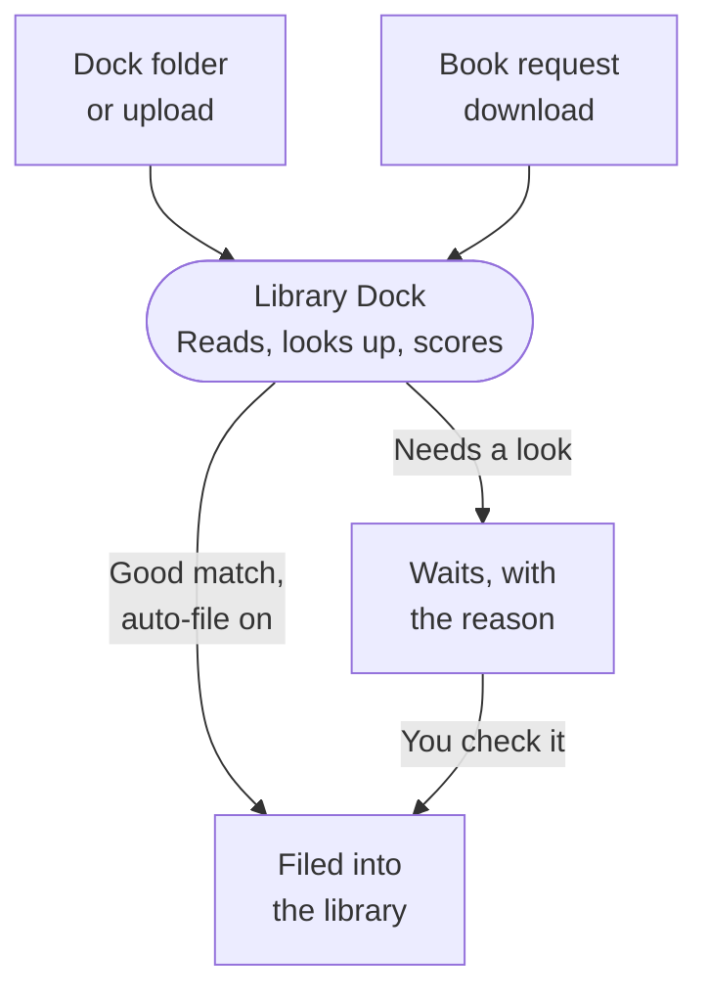
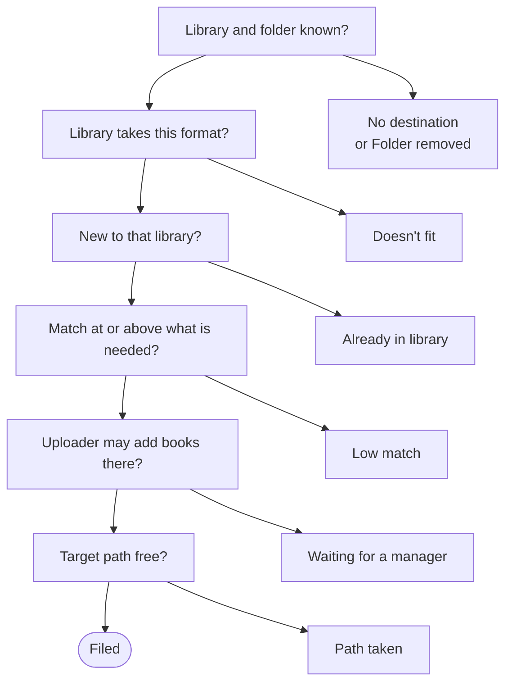

New books rarely arrive tidy. A novel from a store you trust has perfect metadata, a scan from a forum calls itself `Welsh, Irvine - Skagboys`, and an audiobook comes with the wrong cover. You want the good ones on the shelf without a second look, and the odd ones held back until you have checked them.

The **Library Dock** is the waiting room for those files. BookOrbit reads each file's own metadata and cover, looks the book up with your metadata providers, and scores how well the two agree. Then the file either goes into a library on its own or waits, with the reason it is waiting, until you file it.



:::note
Docks for individual libraries need BookOrbit v3.9.0 or later, and uploading to them from the iPhone needs the iPhone app 1.9.0 or later. Earlier versions call this area **Book Dock** and have one shared folder, which is now the **Unsorted** dock. Files, settings and permissions carry over, and an older iPhone app keeps uploading to Unsorted.
:::

---

## How the Dock Is Organised

The dock is one folder on the server, set by `BOOK_DOCK_PATH`. In the Docker image it is `/data/book-dock`. Inside it there are two kinds of dock.

| Dock | Where its files go | What happens to them |
|------|--------------------|----------------------|
| **Unsorted** | Straight into the dock folder | They wait for you to choose a library, unless Unsorted has a library of its own. |
| **A library's dock** | Into `_libraries/<folder>/` | They are already headed for that library and follow that dock's rules. |

```text
book-dock/
├── The Pearl.epub           → Unsorted
└── _libraries/
    ├── Novels/
    │   └── Dune.epub        → Novels dock
    └── Comics/
        └── Saga 01.cbz      → Comics dock
```

- Subfolders inside a dock are fine; BookOrbit looks inside them.
- Files placed directly in `_libraries/`, and folders there that no dock owns, are not picked up. Dock managers see them under [Folders That Need You](#folders-that-need-you).
- System and NAS leftovers are ignored: `._*` files, `@eaDir`, `#recycle` and `.stfolder`.
- Moving a file from one dock folder to another counts as a new arrival.
- [Book request](/book-requests) downloads land in the dock folder itself but appear under the dock of the library they are headed for.

:::caution
Keep the dock folder and your library folders apart. BookOrbit refuses to save a library whose folder sits inside the dock folder or contains it.
:::

---

## Who Can Use It

| Permission | What it allows |
|------------|----------------|
| **Library Dock** | Open the dock, upload into it, and check and file your own uploads. |
| **Manage Library Dock** | See every file, change dock settings, turn docks on and off, and deal with dock folders. |

Users who are not dock managers see only the files they uploaded. Uploading into a library's dock also needs access to that library.

An upload can only file itself when its uploader may add books to the library: the **Upload books** permission and access to that library. Otherwise it waits for a dock manager. Files dropped into a dock folder on the server have no uploader, so this check does not apply to them.

---

## Turn On a Library's Dock

Libraries have no dock until you turn one on, so nothing changes for a library you leave alone.

1. Open **Settings > Server > Library Dock**. The **Docks** table lists Unsorted and every library.
2. Turn on the switch in the **On** column for the library.
3. Check the **Folder** name and choose which of the library's folders the dock **Files into**.
4. Click **Turn on**. BookOrbit creates `_libraries/<folder>/`.


The folder name starts as the library's name and ignores case. If a folder with that name already sits in `_libraries/`, the dock takes it over and picks up the files inside. Dock managers can also start here from **Add a dock** on the dock page.

Once a dock is on, its row in the table shows how it files, and the pencil opens its settings.


| Filing | What it means |
|--------|---------------|
| **Move** | The dock and the library are on the same disk, so filing a book is an instant move. |
| **Hardlink** | The dock keeps originals, and each book is linked into the library without using more space. |
| **Copy** | The dock and the library are on different disks, so each book is copied and takes up space twice. |

Turning a dock off stops it picking up new files. Files already waiting keep their library and can still be filed, and nothing is deleted.

---

## Decide How Each Dock Files

The **Defaults** at the top of **Settings > Server > Library Dock** apply to every dock unless a dock says otherwise.


| Default | What it does |
|---------|--------------|
| **Auto-fetch metadata from providers** | Looks each new file up with your metadata providers. If the lookup fails, the file is still ready to check. |
| **Auto-file** | Files books whose match reaches the **Confidence threshold** without asking. Off until you turn it on. |
| **Confidence threshold** | The match auto-file needs, from 50% to 100%. |
| **Metadata mode** | Which metadata an auto-filed book gets; see the table below. |

| Metadata mode | The book gets | Uses the threshold? |
|---------------|---------------|---------------------|
| **Safe merge** | What providers found wherever they have a value, and the file's own metadata everywhere else. | Yes |
| **Fetched only** | Only what providers found. | Yes |
| **Embedded only** | Only the file's own metadata. | No: any ready file can be filed. |

Your own edits in the dock beat all three. With **Safe merge**, a field the provider has a value for replaces the file's value, even when the file's was right. For a source whose files are already tagged the way you want, use **Embedded only** for its dock.

### A dock's own settings

Click the pencil on a dock's row. Anything left on **Default** follows the defaults, and shows their value, for example **Default (85%)**.


| Setting | What it does |
|---------|--------------|
| **Folder** | Renames the folder on disk. Scripts, download clients and sync tools that use the old path stop working. |
| **Files into** | The library folder the dock files books into. |
| **Auto-fetch metadata**, **Auto-file**, **Match needed**, **Metadata mode** | This dock's own values for the defaults above. |
| **Join matching books** | Adds a file to a book already in the library when they share an ISBN, ASIN or provider id. Title and author alone never join. Off by default. |
| **Keep originals** | Leaves each file in the dock for a download client; see [Keep Originals for Seeding](#keep-originals-for-seeding). |

**Unsorted** has a shorter list: **Library for files without one** (the library and folder auto-file uses for Unsorted files), **Join matching books** and **Keep originals**. Everything else follows the defaults. With no library set, Unsorted files wait with **No destination** whatever their match.

---

## Keep Originals for Seeding

A download client needs its files to stay where it put them while it seeds. With **Keep originals** on, the dock leaves the original in place and links it into the library, so the two share the same space on disk.


- When a hardlink is impossible, such as across disks or separate Docker mounts, BookOrbit copies the file instead.
- Filed originals leave the list. The dock counts them as **kept for seeding** and forgets each one once the download client removes the file.
- **Discard** hides a file and remembers to skip it. The file stays on disk for the download client.
- Uploads are never kept: they are moved when filed and deleted when discarded. Only files placed in the folder stay behind.
- Writing metadata into a book file later gives the library its own copy, so the seeding original never changes. From then on the two use space separately.

---

## Add Files

| Way in | Where the file goes |
|--------|---------------------|
| Copy or move it into a dock folder on the server | The dock that owns the folder. Click **Rescan** if it does not appear. |
| **Upload** on the dock page | The dock you are looking at, or Unsorted when you are looking at **All**. |
| **Upload** on a library page | The library's dock or the library itself, as you choose; see below. |
| The iPhone app | Unsorted or a library's dock, chosen in the upload sheet. |
| A [book request](/book-requests) download | The dock folder, shown under the dock of the request's library. |

When a library has a dock, its **Upload** asks **How to add them**. **Review in dock first** sends the files to that library's dock, where metadata is fetched and you check them. **File now** adds them to the library straight away with the metadata inside the files. BookOrbit remembers your choice for each library.


### From the iPhone app

In **More > Uploads**, tap **+** and choose the files. The **To** menu lists your libraries, then **Library Dock** ("Hold for review on the web") and each library dock you can use, such as **Novels dock**.


The app lists library docks only when the server has them, so with an older server it offers **Library Dock** alone.

### Formats and size

| Type | Formats |
|------|---------|
| Ebooks | EPUB, KEPUB, PDF, DjVu, MOBI, AZW, AZW3, FB2 |
| Comics | CBZ, CBR, CB7 |
| Audiobooks | M4B, M4A, MP3, OPUS, OGG, FLAC |

Uploads follow **Maximum upload file size limit** under **Settings > Library > Maintenance**, 4,096 MB unless you change it. Copy larger files into the dock folder instead. An upload into a library's dock is refused before any data is sent when that library does not take the format.

---

## Work Through the Dock

Click **Library Dock** in the sidebar. Its badge counts the files in the dock.


| Part of the page | What it does |
|------------------|--------------|
| Dock switcher | Switches between **All**, **Unsorted** and each library's dock, with counts. **Off** marks a dock that is turned off. |
| Status tabs | Filter by **All**, **On hold**, **Working**, **Ready** and **Error**. |
| Search | Filters by file name only. |
| Sort | **Needs attention** first, or **Recently added**, **File name**, **Size**, **Format** or **Status**. |
| **Pause** | Stops processing files, including lookups and auto-filing, until you resume. |
| **Rescan** | Looks through the dock folders again for files that did not appear. |

When you look at one library's dock, a strip under the switcher shows its folder, where it files, its auto-file match and how it files, with a link to **Dock settings**.

Each row shows the file's own cover and the new one, the title, author, size and format, and the target library and path. On the right are the match score, any reason it is waiting, and the buttons:

| Button | What it does |
|--------|--------------|
| **Apply** | Uses the fetched metadata for this file. |
| Library name, or **Set destination** | Changes where the file will be filed. The file does not move until it is filed. |
| Pencil | Opens **Edit details** to change metadata or search providers yourself. |
| Arrow circle | Looks the file up again. |
| Bin | Discards the file. |
| **File** | Files it now. |
| **Resolve** | Opens the choices for a file that is already in the library. |

Open a row to see **Proposed changes**: each field the lookup would change, the file's value struck through and the new one beside it.


---

## Why a File Is Waiting

A file that is not filed always says why, and the **On hold** tab collects them. The **Why** chips filter the list by one reason.


Before filing, BookOrbit asks these questions from the top. The first answer of "no" stops the file, with the reason beside it. The match and uploader checks only apply when auto-file is on; with auto-file off, the others still run, so a waiting file shows what would stop **File** from working.



| Reason | What it means | What to do |
|--------|---------------|------------|
| **Low match** | The score is below what this dock needs, for example "65% match, needs 85%". | Check the proposed changes, fix or apply metadata, then **File**. |
| **Already in library** | A book in the target library shares an ISBN, ASIN, provider id, or title and author. | **Resolve**: **Add as format**, **Keep both**, **Discard**, or **Open the book** to compare. |
| **Doesn't fit** | The target library does not take this format. | **Move to** another library, or add the format to the library's **Allowed formats**. |
| **Layout doesn't fit** | A group of files, such as an audiobook in parts, that the library cannot store as one book. | Choose another library. |
| **Path taken** | Another file already sits at the target path. | Change the destination, the metadata the file name uses, or the naming pattern. |
| **No destination** | An Unsorted file with no library. | **Set destination**, or give Unsorted a library. |
| **Folder removed** | The library no longer has the folder its dock files into. | **Choose a folder**. |
| **Waiting for a manager** | The uploader cannot add books to the target library. | A dock manager files it. |

A matching book in a different library shows as an **Also in** note. It is information only and does not hold the file.

**Add as format** puts the file into the existing book, for example an EPUB beside an audiobook. **Keep both** files it as a second book.

### How the match score is worked out

The score compares the file's own metadata with what the providers found.

| What agrees | Score |
|-------------|-------|
| The same ISBN-13 | 95% |
| The same ISBN-10, or the same ISBN in its other form | 90% |
| Two different ISBNs | 10% |
| Otherwise: title | Up to 55 points |
| Otherwise: authors | Up to 30 points |
| Otherwise: published year | 10 points |
| Otherwise: series | 5 points |

The title comparison ignores case, common words such as "the", and anything after ": " or " - ", which it treats as a subtitle. A file whose title starts with the author, such as `Welsh, Irvine - Skagboys`, therefore scores low even when the book is right. Treat the score as a reason to look, not as proof either way.

---

## Check and Fix Metadata

The dock keeps three layers of metadata for every file.

| Layer | Where it comes from | When it is used |
|-------|---------------------|-----------------|
| **Embedded** | Read from the file. | When nothing else is chosen. |
| **Fetched** | Returned by your metadata providers. | Once you click **Apply**, or auto-file chooses it. |
| **Selected** | Your edits, or fetched metadata you applied. | First, ahead of the other two. |

The pencil opens **Edit details**: title, subtitle, authors, description, publisher, year, language, ISBN, series, genres, cover URL and destination. **Search Metadata** looks the book up again with your own search, and a side-by-side view lets you take only the fields you want. An audio file is searched as an audiobook and an ebook as a book, so each is offered covers of the right shape.

Edits are saved in the dock and used when the book is filed. They do not change the file.

When a book is filed, its chosen cover becomes the cover for that kind of file: the audiobook cover for an audio file, the book cover otherwise. Adding an audiobook to a book that already has an ebook keeps its book cover.

---

## File Books

Select files with the checkboxes. The bar above the list then offers:

| Action | What it does |
|--------|--------------|
| **File N to library** | Opens the filing dialog for the selected files. |
| **Set Destination** | Gives the selected files one library and folder. Only their target changes. |
| **Apply Fetched** | Uses fetched metadata on every selected file that has it. Files you edited by hand are skipped. |
| **Retry Errors** | Looks failed files up again. |
| **Bulk Edit** | Sets shared fields such as language, publisher, series or genres. List fields can be added to instead of replaced. |
| **Discard** | Removes the files from the dock and deletes them from disk. In a dock that keeps originals, the files stay on disk. |

The filing dialog checks the selection and shows a **Rename preview** of where each file will go.


- If some files have no destination, the dialog asks for a **Default Destination Library** and **Default Destination Folder**, used for those files only.
- **Add to an existing book** lets you pick the book a file is another format of.
- Click **Start**. Filing can partly succeed; the results list what was filed, what was already in the library and what failed.

Filing checks access to the library and the format, never overwrites an existing file, moves or links the file, creates the book with its metadata and cover, and removes it from the dock. The path in the preview follows the library's file naming pattern if it has one, then the upload naming pattern, then the original file name.

---

## Notifications

When auto-file works through a batch, each dock sends one summary once it has been quiet for five minutes, or after an hour of steady arrivals, for example **Library Dock: Novels**, "482 books filed, 18 need review." A single filed book gets a notification of its own.

The uploader hears about their own uploads. Dock managers hear about files dropped into a dock folder. Choose what you receive under the **Library Dock** category in your notification preferences.

---

## Folders That Need You

Dock managers see a **Folders that need you** panel on the dock page when something in `_libraries/` cannot be picked up.


| What you see | What it means | What to do |
|--------------|---------------|------------|
| "Matches EPUB3, which has no dock." | The folder is named after a library whose dock is off or missing. | **Turn on EPUB3 dock** to adopt the folder and its files. |
| "No library dock owns this folder" | No library goes with this folder name. | **Move to Unsorted**, or **Remove folder** once it is empty. |
| "Loose files, outside any library dock." | Files sit directly in `_libraries/`. | Move them into a dock's folder or the dock folder itself. |

### When a library changes

| What happened | What the dock does |
|---------------|--------------------|
| The library was renamed | The dock keeps its folder name, and the table marks it **Old name**. **Rename folder to** in the dock's settings brings the two back in line. |
| The library lost the folder its dock files into | The dock's files wait with **Folder removed** until you **Choose a folder**. |
| The library was deleted | Its waiting files move to Unsorted, marked with the library they came from. The folder stays on disk and appears in the panel above. Files are never deleted. |

---

## Typical Setups

### Check everything by hand

1. Leave auto-file off and add files to Unsorted.
2. Wait for **Ready**, then open rows and apply or fix metadata.
3. Select files, set a destination and check the rename preview.
4. File them and look through any failures.

### One trusted source per library

1. Turn on a dock for the library.
2. In its settings, set **Auto-file** to **On** and **Match needed** to 85% or more, with **Safe merge**. For a source that tags its files well, choose **Embedded only** instead.
3. Point the source, whether a sync tool or a script, at `_libraries/<folder>/`.
4. Look at the **On hold** tab now and then for the files it left for you.

### Downloads that keep seeding

1. Put the dock on the same disk and Docker mount as the download client's finished folder.
2. Turn on **Keep originals** for the dock and check that its **Filing** says **Hardlink**.
3. Have the download client save finished files into the dock's folder.

---

## Troubleshooting

### A file does not appear

Check that it has a supported extension, has finished copying, and sits in the dock folder or in the folder of a dock that is on. Files directly in `_libraries/` and in folders no dock owns are not picked up. Then click **Rescan**.

### A file stays in Working

Check that the dock is not paused, then click **Rescan**. A file that cannot be read moves to **Error** with a message.

### Search does not find a title

Search looks at file names only. Open the row to see its metadata.

### The match is low but the book is right

Open the row and check **Proposed changes**. Titles with the author in front, or with a series name before a dash, compare badly; see [How the match score is worked out](#how-the-match-score-is-worked-out). **Apply** the fetched metadata or edit the title, then **File**.

### Apply Fetched skipped some files

Those files either have no fetched metadata or have your own edits. Open one and use **Search Metadata** to take provider fields anyway.

### Filing copies instead of moving

The dock and the library are on different disks or separate Docker mounts, so a move or hardlink is impossible. Put both under one mount to file instantly and, with **Keep originals**, without using space twice.

### An upload is refused because the library does not take the format

Upload to another dock, or add the format to the library's **Allowed formats** under **Settings > Libraries > Edit > Scanner**.

### The iPhone app does not list a library's dock

The dock must be on, you need access to its library, and both the server and the app must be recent enough for library docks. Until then the app uploads to Unsorted.

### Library docks will not turn on

An older version may have taken in a folder named `_libraries` from the dock as a book. The settings page says so; file or move that book, and library docks can be turned on.

### Filing says the file already exists

Something already sits at the target path. Change the destination, the metadata the naming pattern uses, or the pattern, or remove the existing file.
