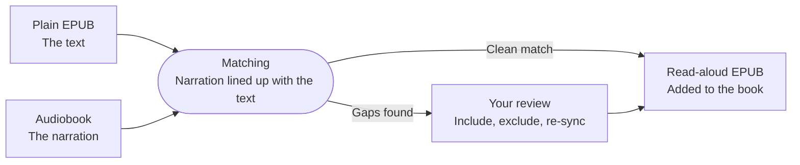

Some books you own twice: the EPUB you read on the train and the audiobook you listen to while you cook. Your place in one means nothing in the other.

A **read-aloud EPUB** is the same book as one file: the text, the narration, and a timing map that says which sentence is spoken when. The sentence being read lights up as it plays, and stopping the audio to read puts you exactly where the narrator left off. [Storyteller Read-Aloud Books](/storyteller-read-aloud) covers what that file does on every device.

You can bring one in from outside, or make it here. **Create read-aloud** takes the EPUB and audiobook already on a book, lines the narration up with the text, and adds the result as a new EPUB. The files you started from are never touched.



## Before you start

- **A worker is running.** Matching is heavy, so a separate *read-aloud worker* does it, not the BookOrbit server. Whoever runs your server sets it up once; see [Setting up the worker](#setting-up-the-worker). Without one, the button does not appear.
- **You have the permission.** **Generate read-aloud books** (`library_generate_read_aloud`), which also needs **Upload books**. Superusers have it already. See [Users & Permissions](/users#content).
- **The book has both halves.** A plain EPUB and audiobook files on the same book, in a **Folder as Book** library (a **File as Book** library never offers the feature; see [Library File Structure](/library-file-structure#audiobook-with-companion-ebook)). An existing read-aloud EPUB cannot be the source, so the plain EPUB has to stay on the book if you ever want to regenerate.

The narration must be a recording of the same text. An abridged audiobook or a different edition still produces a result, but with gaps; that is what [review](#when-it-needs-your-eyes) is for.

## Starting one

Open the book, go to **Files**, and press **Create read-aloud**.


The button is hidden when no worker is configured or the book can never qualify (no audiobook, or a **File as Book** library). When it cannot work right now, it stays visible but inert and a line under the bar says why. Two of those reasons need a fix outside the book:

- **The worker can't reach this library's folder.** Mount the folder into the worker and list it in `READ_ALOUD_LIBRARY_ROOTS`.
- **This library doesn't accept EPUB files.** Add EPUB to the library's **Allowed formats** under **Settings > Libraries > Edit > Scanner**.

One job takes at most 2,000 audio files, and a book runs one job at a time.

## The dialog


**Ebook.** The plain EPUB to match. Choose the one that matches the narration when the book has several.

**Existing read-aloud.** If the book already has one, the dialog asks what to do:

- **Replace** swaps the old file in place, for everyone who can open the book, and only after the new one passes its checks. Reading positions, sessions and highlights carry over. This is the default when BookOrbit made the old file (**Made by BookOrbit**). With several existing read-alouds, each is offered for replacement.
- **Keep both** adds the new one as another file. This is the default for an imported file (**Imported**, for example from Storyteller), so it is never overwritten by surprise.

**Audiobook.** Tracks are used in the book's own order. With several tracks, **Change order** lets you reorder them or skip one.

**Narration language.** Required. BookOrbit pre-selects the book's language when the speech model supports it, and leaves it empty otherwise. The model covers Arabic, Armenian, Catalan, Chinese, English, Faroese, French, German, Icelandic, Italian, Japanese, Kazakh, Maltese, Polish, Portuguese, Russian and Spanish, and BookOrbit never substitutes another.

:::tip[A wrong language does not fail]
Choose Spanish for English narration and the job still runs, matches badly, and lands in review. Check the language first.
:::

Under **Advanced**, **Highlighting** is **Sentence** by default, which is the one to use. **Word** highlights each word, takes longer, makes a larger file, and is **Experimental**.

The summary at the bottom shows where the model will run, an estimated output size, and a **Low disk space** warning if the worker is short of working space.

## While it works

A **Read-aloud** card appears above the file list and keeps going if you leave the page.


| Step | What happens |
|------|--------------|
| **Audio** | The audiobook is prepared, and split into tracks if it is one big file. |
| **Speech** | The worker listens to every track. This is the long one. |
| **Text** | The EPUB is marked up sentence by sentence. |
| **Align** | Spoken and written words are matched, chapter by chapter. |
| **Check** | The result is validated before anything touches your library. |
| **Publish** | The EPUB is added to the book. |

A job waiting its turn shows how many are ahead; the worker does one at a time. The first job in a language also downloads its speech model. **Details** opens the activity log, the first place to look if something stalls. **Cancel generation** stops at the next safe point and adds nothing.

On an Apple Silicon Mac with the native worker, a 7-hour audiobook took about three minutes in testing. The CPU-only Docker worker is slower, and long books can take hours there.

Do not move or replace the EPUB or the audio while a job runs; it fails with **A selected file changed after the job started**.

Only the person who started a job and superusers can cancel, retry, publish or discard it. Other people who hold **Generate read-aloud books** and can open the book see that it is running; everyone else sees no card at all.

## When it needs your eyes

A job waits for review when none of the text matched, an audio track could not be aligned, or more than a tenth of the story text found no place in the narration.


Every chapter is listed with a status and how much of its text matched:

| Status | Meaning |
|--------|---------|
| **Aligned** | Found in the narration. |
| **Not found in the audio** | The chapter's text could not be located in the narration. |
| **Too short to match** | Too little text to match reliably. |
| **Audio only** | The narration covers this part, but there is no matching text to highlight. |
| **Not in the narration** | Front or back matter beyond where the narration starts and ends, such as the copyright page, contents or a sample of another book. Left without audio, and not counted against the result. |

The headline percentage is judged on the text the narration covers, from the first chapter that clearly matched to the last. A book can read **100% of the text matched** and still wait for review, because an unaligned track is enough on its own; the rows show where.

Untick a chapter that should not be matched, such as a title page the narrator skipped. The card then says **1 change is not applied yet**, and:

- **Re-sync** applies your changes and reruns only the matching step, reusing the earlier work.
- **Publish anyway** adds the output as it is.
- **Discard** adds nothing.

An unreviewed job gets a reminder after 7 days and is discarded after 14.

## When it is done


The card says whether the EPUB was **added as a new file** or **replaced the previous read-aloud**, how many sentences found their place, how much of the audio was used, and which chapters were left without audio. **With warnings** means the file is usable but worth a glance. **Open read-aloud** opens it in the reader, and **Show file** jumps to it.

The file is named `<book>.readaloud.epub` and sits in the book's folder. Publishing ignores the admin upload size limit; the only cap is `READ_ALOUD_MAX_OUTPUT_BYTES` (20 GB by default), and BookOrbit checks the library volume has room first. **Details** keeps the chapter table after the job is finished.

From here the file is an ordinary read-aloud EPUB: Read Along on the web and iOS, narration on Apple Watch, and audio-free copies for Kobo and KOReader. [Storyteller Read-Aloud Books](/storyteller-read-aloud) covers each.

## When it fails

The card says why, and the activity log has the detail. **Retry** continues from the last finished step; the work is kept for 7 days. **Start over** reopens the dialog with the same choices. After a worker or server restart, a running job resumes from its last finished step by itself.

The requester is notified, under **Read-aloud generation** in notification settings, when a job is ready, needs review, has a review about to expire, or fails.

## Setting up the worker

For whoever runs the server. The worker prepares audio, runs the speech model, matches the text and builds the EPUB. It reads libraries read-only and writes only to its own folder. Both sides share one secret: generate it with `openssl rand -hex 32`. `READ_ALOUD_WORKER_TOKEN_FILE` works in place of the token variable, like [other secrets](/installation#secrets-from-files).

### With Docker

Add to the deployment's `.env`:

```dotenv
COMPOSE_PROFILES=read-aloud
READ_ALOUD_WORKER_URL=http://read-aloud-worker:8787
READ_ALOUD_WORKER_TOKEN=<a-random-secret-of-at-least-16-characters>
READ_ALOUD_WORKER_IMAGE=ghcr.io/bookorbit/bookorbit-read-aloud-worker:latest
```

```bash
docker compose up -d --wait
```

The image runs on the CPU. It mounts your library at `/books` (read-only) and `data/app/read-aloud` for job folders, models and temporary files. Keep that folder on persistent storage: the first job in each language downloads its model (about 190 MB for English) from Storyteller's model registry, which needs outbound HTTPS once.

**Libraries in other folders.** The worker only reads folders in `READ_ALOUD_LIBRARY_ROOTS` (comma-separated, default `/books`). For a library mounted elsewhere, mount it into the worker read-only at the same path and list it:

```yaml
services:
  read-aloud-worker:
    volumes:
      - /srv/audiobooks:/audiobooks:ro
```

```dotenv
READ_ALOUD_LIBRARY_ROOTS=/books,/audiobooks
```

### Natively, for Apple Silicon

Docker Desktop on a Mac cannot reach the GPU. To use it through MLX, run the worker natively. You need Node.js 24 or later, pnpm, and `ffmpeg` with `ffprobe` version 7 or newer (`brew install ffmpeg`). The worker refuses to start with an older one.

From a checkout of the BookOrbit repository:

```bash
pnpm install
pnpm --filter @bookorbit/types build
pnpm --filter @bookorbit/read-aloud-worker build

READ_ALOUD_WORKER_TOKEN=<shared-token> \
READ_ALOUD_LIBRARY_ROOTS=/path/to/library \
READ_ALOUD_WORK_ROOT=/path/to/app-data/read-aloud/jobs \
pnpm --filter @bookorbit/read-aloud-worker start
```

The worker must see book files at the same paths as the server, and its job folder must be the server's `<APP_DATA_PATH>/read-aloud/jobs`. Point the server at it:

```dotenv
READ_ALOUD_WORKER_URL=http://127.0.0.1:8787
READ_ALOUD_WORKER_TOKEN=<shared-token>
```

A native worker listens on `127.0.0.1` only. To reach it from elsewhere, set `READ_ALOUD_WORKER_HOST` and keep the port off untrusted networks; the token is the only protection.

### Where the model runs

`READ_ALOUD_CTC_DEVICE` picks the runtime:

| Value | Runtime |
|-------|---------|
| `auto` | MLX on native Apple Silicon, otherwise CPU. |
| `cpu` | Everywhere; the only option in the Docker image. |
| `mlx` | Native macOS on Apple Silicon. |
| `cuda` | Native Linux x64 with CUDA 12 and cuDNN 9; never chosen by `auto`. |
| `webgpu` | Experimental; not available on Linux arm64. |

An explicit setting the host cannot run stops the worker at startup instead of quietly falling back to the CPU.

### Disk space

A run needs about four times the size of the audio, plus seven times the EPUB, plus the model's working data (about 115 MB for a 10 hour book), plus 512 MB. The worker fails the job with `insufficient_storage` if that is not free, and the dialog warns beforehand. Publishing needs one more copy of the output on the library volume.

## Troubleshooting

**Language says it is not supported.** The book's recorded language is not one the model covers, or is recorded in a form BookOrbit does not recognise. Choose it yourself from the list.

**Almost everything landed in review.** Check the language, then the edition. A different or abridged recording will not line up with the EPUB, and no setting fixes that.

**The native worker will not start.** Check the log: an `ffmpeg` or `ffprobe` older than version 7 is refused at startup, as is a `READ_ALOUD_CTC_DEVICE` the host cannot run.
